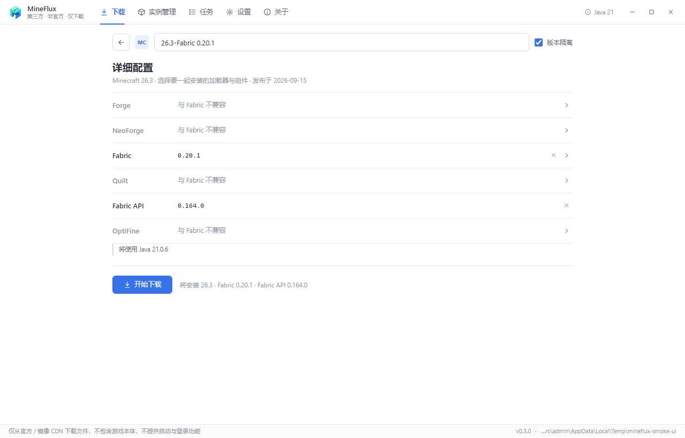
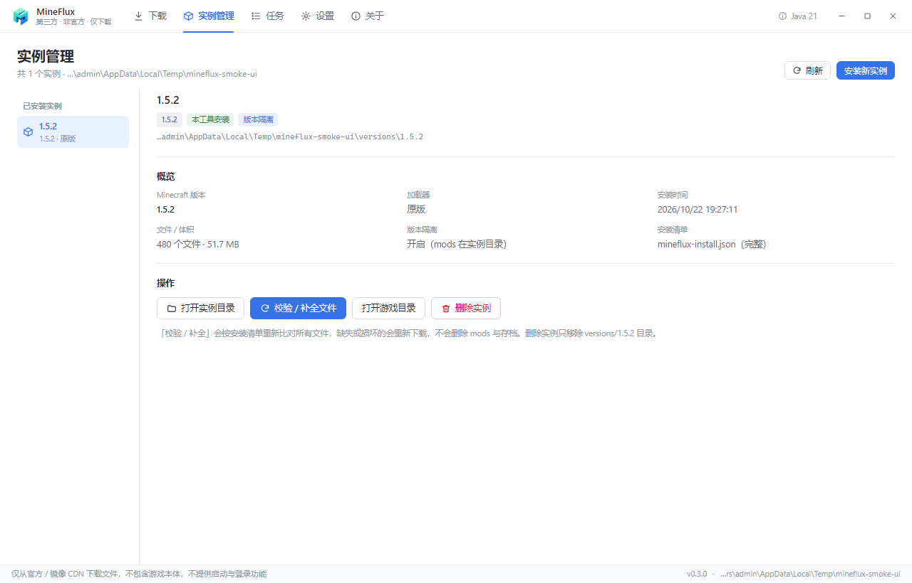

# MC Downloader

一个**独立的、只做下载与安装**的 Minecraft 客户端安装工具，使用 **TypeScript + Electron + React** 从零实现。

它的并发下载引擎、镜像源改写规则、加载器安装流程、整合包识别逻辑等设计参考了开源启动器 PCL（Plain Craft Launcher 2）的下载模块，但代码为完全重写，不包含 PCL 的任何源码。

> 第三方非官方工具，与 Mojang / Microsoft / PCL 均无关联。
> 只从官方与公共镜像 CDN 实时拉取文件，**不内置、不转存任何游戏资源**，也**不提供启动、登录、正版验证**功能。


## 界面

整体框架参照 PCL 的 WPF 布局重排（无边框窗口 + 标题栏一级导航 + 每页左侧子导航），不是单页堆面板。

视觉上是浅色极简风格：纯白背景、细分隔线排版，不使用卡片 / 阴影 / 渐变，只保留一个蓝色强调色；控件使用轻描边，具体表现在标题栏、侧边导航与各页面中。

- **自定义标题栏**：左侧 Logo，中间一级导航「下载 / 实例管理 / 任务 / 设置 / 关于」，右侧 Java 状态胶囊与最小化 / 最大化 / 关闭按钮，对应 PCL 的 `FormMain` 标题栏导航。
- **左侧子导航 + 右侧内容**：每个页面沿用 PCL 的 `MyPageLeft + MyPageRight` 结构——左侧单选列表（下载类型、设置分类、实例列表），右侧为页面标题行 + 可滚动内容区。
- **下载页**：左列版本列表 + 安装目录，右列版本详情与「配置并安装」入口；「整合包」子页支持拖拽与文件解析。
- **详细配置页**：对应 PCL 的安装详细配置——返回箭头 + 实例名输入框，中间是可互斥的组件列表（Forge / NeoForge / Fabric / Quilt / Fabric API / OptiFine / OptiFabric / LiteLoader），选中项显示版本号并可清除或展开版本列表；不兼容的组件行会变灰并给出原因（如「与 Fabric 不兼容」），Fabric API / OptiFabric 按 PCL 逻辑自动跟随安装，底部为「开始下载」。
- **任务页**：完整进度、分阶段进度、失败重试与运行日志，对应 PCL 的任务管理页。
- **实例管理页**：左侧实例列表，右侧概览（MC 版本 / 加载器 / 安装时间 / 文件数 / 隔离 / 清单状态）与操作（打开目录、校验补全、删除）。
- **设置页**：下载源、并发与校验、安装目录、CurseForge API Key、Java 检测。
- **关于页**：功能边界、数据来源、许可与 PCL 参考说明。

| 详细配置 | 实例管理 | 设置 |
|---|---|---|
|  |  |  |

## 功能

### 原版安装

- **版本列表**：Mojang 官方清单 + BMCLAPI 镜像，支持按正式版 / 快照 / 远古版筛选与搜索，标记最新版与已安装实例。
- **完整原版下载**：版本 JSON、客户端 jar、`libraries/` 依赖库、资源索引、`assets/objects/` 全部资源、log4j 日志配置。
- **校验与修复**：对目标目录中已存在的文件逐个 SHA1 + 大小校验，只补缺失/损坏的文件（即 PCL 的“补全/修复”逻辑）。

### 加载器安装

对应 PCL 的 `McInstallLoadersGet()`，按 PCL 的叠加顺序 **Forge/NeoForge → OptiFine → LiteLoader → Fabric/Quilt** 合并版本 JSON：

| 加载器 | 实现方式 | 需要 Java |
|---|---|---|
| Fabric | Fabric Meta API 拉取 profile JSON（`inheritsFrom` 合并） | 否 |
| Quilt | Quilt Meta API 拉取 profile JSON | 否 |
| Forge ≤ 1.12.2（主版本 < 20） | 解包官方 installer：读取 `install_profile.json` 的 `version.json` / `versionInfo`，释放 `maven/` 内置库 | 否 |
| Forge ≥ 1.13（主版本 ≥ 20） | 运行官方 installer `--installClient`，读取生成的版本 JSON | **是** |
| NeoForge | 运行官方 installer（BMCLAPI 版本列表） | **是** |
| OptiFine ≤ 1.13.2 | 免 Java：jar 释放到 `libraries/optifine/...`，构造 launchwrapper + tweaker 的版本 JSON | 否 |
| OptiFine ≥ 1.14 | 运行 OptiFine installer（临时 home 目录 + 复制回 `.minecraft`） | **是** |
| LiteLoader | 免 Java：按 `versions.json` 构造 tweakClass / libraries / `inheritsFrom` | 否 |
| Fabric API / OptiFabric | Modrinth API 按 MC 版本 + 加载器解析后放进 `mods/` | 否 |

Fabric/Quilt 与 OptiFine 同时选择时，按 PCL 的做法把 OptiFine 当作 Mod 安装（此时需要勾选 OptiFabric）。

### 实例语义

对应 PCL 的 `PathIndie` / `McInstallManifest` / `.pclignore`：

- 可自定义**实例名称**（自动按 PCL 的文件夹名校验规则清洗非法字符 / 保留名）。
- **版本隔离**：开启后 `mods` / `resourcepacks` / `shaderpacks` 放进 `versions/<实例>/`，关闭则放进游戏根目录。
- 实例版本 JSON 会合并全部加载器、移除 `inheritsFrom` / `jar`、改写 `id`，并复制实例 jar。
- 安装过程写 `.pclignore` 标记，安装完成后写 `mcdl-install.json` 安装清单（组件、文件数、体积、完成状态）。
- 同名实例再次安装按 PCL 的「补全 / 修复」语义处理：已存在的文件逐个校验 SHA1，只补缺失或损坏的文件，不会清空 `mods` 与存档。
- **实例管理页**：左侧实例列表，右侧概览与操作，支持「校验 / 补全」与删除实例（只删 `versions/<实例>`）。

### 整合包安装

对应 PCL 的 `ModModpack.vb`，支持 7 类整合包，可点按钮选择文件，也可以直接**拖拽**到窗口：

| 类型 | 识别标志 | 加载器来源 |
|---|---|---|
| CurseForge | `manifest.json`（无 `addons`） | `minecraft.modLoaders[].id`，文件走 CF API / 镜像 |
| Modrinth | `modrinth.index.json` | `dependencies`（`minecraft` / `fabric-loader` / `forge` / `neoforge` / `quilt-loader`） |
| HMCL | `modpack.json` | `gameVersion`，覆盖文件在 `minecraft/` |
| MultiMC / Prism | `mmc-pack.json` + `instance.cfg` | `components[]`（`net.minecraft` / `net.minecraftforge` / `net.neoforged` / `net.fabricmc.fabric-loader`） |
| MCBBS | `mcbbs.packmeta` / 带 `addons` 的 `manifest.json` | `addons`（game/forge/neoforge/fabric/quilt/liteloader/optifine） |
| 启动器整合包 | 内嵌 `modpack.zip` / `modpack.mrpack` | 递归解析内层包 |
| `.minecraft` 备份 | 找到 `versions/<ver>/<ver>.json` | 直接解压覆盖到游戏目录（同名替换） |

RAR 不支持，会给出明确提示。


### 下载引擎

- 全局并发连接池（默认 24，可调 1–64）
- 大文件（≥ 8 MB）自动分片、多段 Range 并发
- 每个文件多下载源顺序尝试，失败自动切换
- 下载源熔断：某域名连续失败后 60 秒内优先使用其它源
- SHA1 + 大小双校验，损坏文件自动丢弃并改用其它源
- `.part` 临时文件 + Range 断点续传，原子重命名落盘
- 实时进度：总进度、速度、剩余时间、分阶段进度（版本 JSON / 客户端 / 依赖库 / 加载器 / 资源 / Mod）、失败列表
- 可暂停、继续、取消、重试失败文件

### 其他

- **下载源策略**：镜像优先（默认）/ 官方优先 / 仅镜像。自动模式下若发现镜像不可用，会自动切换到官方源。
- **无边框窗口**：自绘标题栏与窗口控制按钮，标题栏可拖动，支持最大化 / 还原 / 最小化 / 关闭。
- **Java 检测**：自动探测 `MCDL_JAVA_HOME` / `JAVA_HOME` / PATH / 常见安装目录 / 官方启动器 runtime，用于判断哪些加载器可以安装。
- **CurseForge API Key**：可在设置里填写，也支持 `MCDL_CURSEFORGE_API_KEY` 环境变量；留空时使用镜像接口。

## 快速开始

本项目使用 **Yarn 1（Classic）** 管理依赖，锁文件只有 `yarn.lock` 一份，请勿混用 npm（会生成第二份锁文件）。

```bash
yarn install

# 开发模式（Vite HMR + Electron）
yarn dev

# 生产构建并启动
yarn start

# 仅构建
yarn build

# 类型检查
yarn typecheck
```

### 冒烟测试（无需人工点击）

```bash
yarn smoke
```

会启动应用（冒烟期间窗口短暂显示但不抢焦点），加载完成后逐页截图到 `smoke.png`（下载 / 原版游戏）、`smoke-config.png`（详细配置）、`smoke-modpack.png`（整合包）、`smoke-instances.png`（实例管理）、`smoke-tasks.png`（任务）、`smoke-settings.png`（设置）、`smoke-about.png`（关于），并把界面文本导出到 `smoke.txt`。

```bash
yarn smoke:install
```

在冒烟测试的基础上，通过真实的 **渲染进程 → IPC → 下载核心** 链路完整安装一个 1.5.2 版本（约 52 MB）到临时目录，结束后再逐页截图并输出统计。仓库里的 `docs/screenshot*.png` 都来自这次运行。

### 下载核心端到端测试（不依赖 Electron）

```bash
# 查看某版本的下载清单与体积
yarn run e2e -- plan 1.8.9

# 真实下载到 %TEMP%/mcdl-e2e/1.8.9
yarn run e2e -- install 1.8.9

# 全量 SHA1 复验
yarn run e2e -- verify 1.8.9

# 暂停 / 继续 / 重复安装跳过 / 取消 的流程测试
yarn run e2e -- stress 1.5.2

# 加载器 / 实例 / 整合包 功能验证（Fabric 合并、旧版 Forge 解包、
# OptiFine 免 Java 安装、LiteLoader、多格式整合包、完整实例安装）
yarn run e2e:features

# 详细配置页的互斥 / 自动组件 / 默认实例名规则（纯函数，无需网络）
yarn run test:ui
```

可用环境变量：`MCDL_MODE=auto|official|mirror`、`MCDL_CONCURRENCY=24`。

## 项目结构

```
src/
├─ core/                  # 纯 Node 逻辑，不依赖 Electron，可单独测试
│  ├─ manifest.ts         # 版本清单获取与校验
│  ├─ mirror.ts           # 官方地址 → BMCLAPI 镜像改写（对应 PCL 的 DlSource*）
│  ├─ rules.ts            # version json 的 rules(os/arch/features) 判定
│  ├─ version-json.ts     # inheritsFrom 合并、实例 JSON 规范化（对应 MergeJson）
│  ├─ maven.ts            # maven 坐标 → 仓库相对路径
│  ├─ version.ts          # 解析 version json，生成文件下载清单（含实例路径）
│  ├─ downloader.ts       # 并发下载引擎（分片 / 多源 / 校验 / 熔断）
│  ├─ loaders/            # 各加载器：版本列表 + 产出待合并 profile
│  │  ├─ fabric.ts        # Fabric / Quilt
│  │  ├─ forge.ts         # Forge（新旧安装器格式）/ NeoForge
│  │  ├─ optifine.ts      # OptiFine（免 Java 方法 + 安装器方法）
│  │  ├─ liteloader.ts    # LiteLoader
│  │  ├─ resources.ts     # Modrinth 上的 Fabric API / OptiFabric
│  │  └─ sources.ts       # 各加载器 API / maven 地址与镜像
│  ├─ modpack/            # 整合包识别与安装（对应 ModModpack.vb）
│  ├─ instance.ts         # 实例语义：命名、隔离、.pclignore、安装清单
│  ├─ java.ts             # Java 探测与调用
│  ├─ zip.ts              # 极简 ZIP 读写（整合包/安装器解析）
│  ├─ fsutil.ts           # 原子写入、目录合并等
│  ├─ install.ts          # 安装任务编排（对应 DlClientFix + McInstallLoadersGet）
│  └─ http.ts             # 多源顺序请求、超时、错误归一化
├─ shared/types.ts        # 主进程 ↔ 渲染进程契约
└─ renderer/              # React UI（PCL 式标题栏 + 页面）
   ├─ App.tsx             # 外壳：标题栏、页面切换、全局状态
   ├─ pages/              # 下载 / 详细配置 / 实例管理 / 任务 / 设置 / 关于
   ├─ components/         # 标题栏、侧边导航、版本列表、迷你任务、整合包、任务、日志、图标
   └─ lib/                # 格式化、页面枚举、详细配置的互斥 / 自动组件规则
electron/                 # 主进程与 preload（IPC 桥、无边框窗口控制）
scripts/
├─ dev.mjs                # 开发启动器
├─ launch.mjs             # 启动 Electron（会剔除 ELECTRON_RUN_AS_NODE）
├─ build-electron.mjs     # esbuild 打包主进程
├─ e2e.ts                 # 下载核心端到端测试
├─ e2e-features.ts        # 加载器 / 实例 / 整合包功能测试
├─ test-ui.ts             # 详细配置页规则测试
└─ engine-test.ts         # 下载引擎单测
```

## 安装流程

```
版本清单 (version_manifest.json)
  └─ 版本 JSON (versions/<mc>/<mc>.json)
       ├─ downloads.client        → versions/<mc>/<mc>.jar
       ├─ libraries[]             → libraries/<maven 路径>（按 rules 过滤 + natives classifier）
       ├─ assetIndex              → assets/indexes/<id>.json
       │    └─ objects{}          → assets/objects/<hash[0:2]>/<hash>
       └─ logging.client.file     → assets/log_configs/<id>

加载器阶段（按所选组件，逐个 prepare → mergeVersionJson）
  ├─ Forge / NeoForge profile（解包或运行 installer）
  ├─ OptiFine（免 Java 库 / installer）
  ├─ LiteLoader profile
  └─ Fabric / Quilt profile
       ↓
实例版本 JSON (versions/<实例>/<实例>.json，已移除 inheritsFrom / jar，id 改写)
实例 jar       (versions/<实例>/<实例>.jar)
mods/          (Fabric API / OptiFabric / OptiFine-as-Mod / 整合包 mods)
整合包覆盖文件   (overrides → 数据目录)
安装清单        (versions/<实例>/mcdl-install.json)
```

## 与 PCL 下载逻辑的对应关系

| 本工具 | PCL 对应实现 | 说明 |
|---|---|---|
| `renderer/App.tsx` / `TitleBar` / `SideNav` | `FormMain.xaml`（标题栏导航）、`MyPageLeft / MyPageRight` | 页面框架：标题栏一级导航 + 左侧子导航 + 右侧内容区 |
| `renderer/pages/InstallConfigPage.tsx` / `lib/install-config.ts` | `PageDownloadInstall.xaml.vb`（`LoadXxxGetError` / `ReloadSelected` / `GetSelectName` / 自动选择 Fabric API、OptiFabric） | 详细配置页：组件互斥、不可用原因、自动组件、默认实例名 |
| `mirror.ts` | `ModDownload.DlSourceAssetsGet / DlSourceLibraryGet / DlSourceLauncherOrMetaGet` | 官方地址到 BMCLAPI 路径的改写规则 |
| `manifest.ts` | `DlClientListMain / DlClientListMojangMain / DlClientListBmclapiMain` | 清单获取、条目数合理性校验、源自动切换 |
| `rules.ts` | `ModMinecraft.McJsonRuleCheck` | rules 匹配语义 |
| `version-json.ts` | `ModMinecraft.McJsonMerge`（`MergeJson`） | 多 profile 合并、`inheritsFrom` 展开、实例 JSON 规范化 |
| `version.ts` | `McLibListGetWithJson / McAssetsListGet / McLibNetFilesFromInstance` | 库、natives、资源对象清单 |
| `downloader.ts` | `ModNet.NetFile / NetThread / LoaderDownload` | 分片、多源切换、断点续传、校验、并发调度 |
| `loaders/fabric.ts` | `McDownloadFabricLoader` | Fabric / Quilt meta profile |
| `loaders/forge.ts` | `McDownloadForgeLoader` / `McDownloadNeoForgeLoader` | 旧版解包 / 新版运行 installer |
| `loaders/optifine.ts` | `McDownloadOptiFineLoader` | 免 Java 方法 + installer 方法 |
| `loaders/liteloader.ts` | `McDownloadLiteLoaderLoader` | 按 versions.json 构造 profile |
| `loaders/resources.ts` | `McDownloadFabricAPI / OptiFabric` | Modrinth 解析 Fabric API / OptiFabric |
| `modpack/index.ts` | `ModModpack.vb` | 7 类整合包识别与安装 |
| `instance.ts` | `PathIndie` / `McInstallManifest` / `.pclignore` | 实例隔离、安装清单、安装标记 |
| `install.ts` | `DlClientFix` + `McInstallLoadersGet` | 完整安装编排 |

## 数据来源

| 用途 | 官方 | 镜像 |
|---|---|---|
| 版本清单 / 版本 JSON / 客户端 jar | `launchermeta.mojang.com`、`piston-data.mojang.com` | `bmclapi2.bangbang93.com` |
| 依赖库 | `libraries.minecraft.net` | `bmclapi2.bangbang93.com/maven`、`/libraries` |
| 资源文件 | `resources.download.minecraft.net` | `bmclapi2.bangbang93.com/assets` |
| Forge 安装器 / 版本列表 | `maven.minecraftforge.net`、`files.minecraftforge.net` | `bmclapi2.bangbang93.com/maven`、`/forge/minecraft/<mc>` |
| NeoForge | `maven.neoforged.net` | `bmclapi2.bangbang93.com/neoforge/...` |
| Fabric / Quilt | `meta.fabricmc.net/v2`、`meta.quiltmc.org/v3` | `bmclapi2.bangbang93.com/fabric-meta` |
| OptiFine | `optifine.net` | `bmclapi2.bangbang93.com/optifine` |
| LiteLoader | `dl.liteloader.com/versions` | — |
| Modrinth / CurseForge | `api.modrinth.com/v2`、`api.curseforge.com/v1` | `mod.mcimirror.top` |

BMCLAPI 是第三方公益镜像，使用时请遵守其使用规范，不要滥用并发。

## 已知限制

- **需要 Java 的加载器**：Forge 1.13+、NeoForge、OptiFine 1.14+ 必须运行官方 installer，因此需要本机已安装 Java（Java 8 用于旧版 Forge，Java 17/21 用于新版）。没有 Java 时会在日志里给出明确提示，而不是静默失败。Fabric / Quilt / LiteLoader / Forge ≤ 1.12.2 / OptiFine ≤ 1.13.2 都可以免 Java 安装。
- **OptiFine 1.13.2 以下版本的免 Java 安装**依赖 BMCLAPI 镜像提供的 jar；官方 `downloadx` 链接是临时令牌，失败时会自动回退镜像。
- **LiteLoader 1.12.2 的 SNAPSHOT 构建**在官方服务器上已经 404/500，只能安装可用的 release 构建（如 1.7.10_04、1.12.2_04 之外的旧版）；版本列表里能选到但下载会失败并给出错误。
- **CurseForge 整合包**的单个 mod 文件需要 CurseForge API Key（或镜像接口可用）；否则会把失败记录下来，不会中断其它文件的安装。
- 不处理 1.7 之前的 `virtual` / `map_to_resources` 旧版资源布局。
- 不负责解压 natives 与启动参数拼装（这是启动器启动时的工作，本项目不做启动）。
- 不跨进程续传：`.part` 文件只在同一次会话内用于续传，重启应用后会重新校验并重下损坏分片。
- 主要为 Windows 设计并测试；macOS / Linux 未做验证。

### 与 PCL 被禁用功能的差距

PCL 2.99.0.0 用单一开关 `RestrictMcDownload = True`（`Modules/ModSecret.vb:18`）停掉了 MC 下载功能，实际拦截点共 6 处，影响 3 个功能面。本工具目前的覆盖情况：

| 被禁功能 | PCL 拦截点 | 本工具状态 |
|---|---|---|
| 版本下载安装页整页（版本列表、实例名、7 个 Loader 卡片、开始下载） | `PageDownloadInstall.xaml.vb:17` | 已对齐（版本列表 + 详细配置页：实例名 / 隔离 / 组件互斥与不可用提示 / Fabric API / OptiFabric 自动跟随 / 开始下载） |
| 整合包安装 7 类（CurseForge / HMCL / MMC / MCBBS / Modrinth / 带启动器压缩包 / 裸压缩包） | `ModModpack.vb:11`、`:88` | 已对齐 |
| 资源详情页的整合包「安装」按钮 | `PageDownloadCompDetail.xaml.vb:275` | 本工具没有资源详情页，改为整合包页直接选文件 |
| 拖拽 `.zip` / `.mrpack` 安装整合包 | `FormMain.xaml.vb:1079` | 已对齐（拖拽到整合包面板） |
| 已有实例中更换 MC 本体版本（`CardMinecraft`） | `PageDownloadModify.vb:315` | 部分：可以覆盖安装补全，但没有独立的「换组件」界面 |

另外说明两点，避免误解：PCL 这次**没有**禁用社区资源下载（Mod / 资源包 / 光影 / 存档仍可用），也没有禁 Java 管理；联机入口是 2.12.1 就隐藏的，与本次限制无关。本工具同样不提供这些功能，属于设计范围外。

## 合规与免责声明

- 本项目**只下载与安装文件**，不启动游戏、不提供账号登录，也不包含任何游戏本体或资源文件。
- 所有文件均实时从 Mojang 官方 CDN 或公开镜像获取，本项目不托管、不分发这些文件。
- 使用本项目即表示你已知悉：下载与使用 Minecraft 需遵守 [Minecraft EULA](https://www.minecraft.net/eula) 及你所在地区的法律法规。
- 请自行确认在你的使用场景下这样做是合规的；本项目不提供任何法律意见，也不对使用后果负责。
- 如果你要分发本工具，请勿使用与 PCL 或 Minecraft 官方混淆的名称与图标。

## License

MIT（仅适用于本仓库自身代码；Minecraft 相关资源版权归 Mojang / Microsoft 所有）
